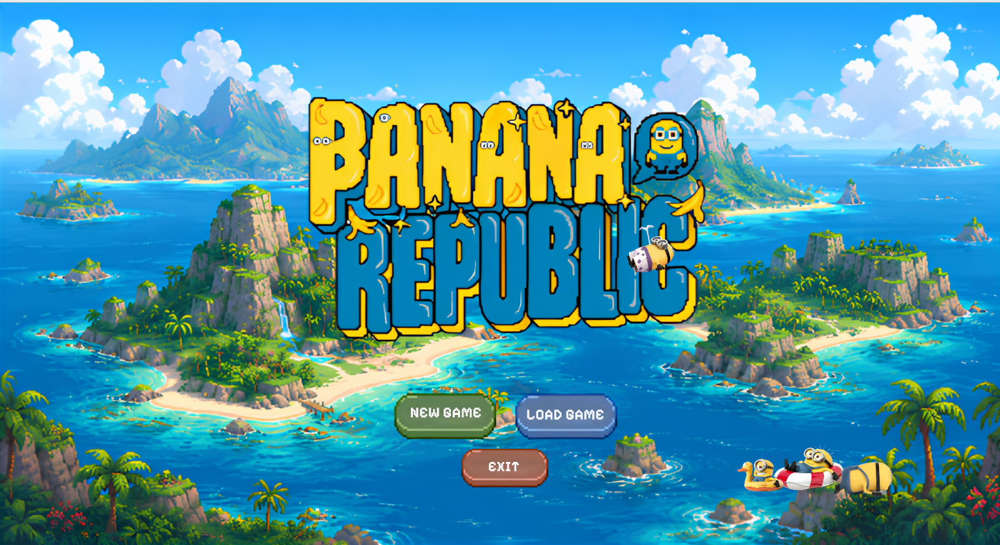

<br/>



<h1 align="center">Banana Republic</h1>
<p align="center">
  A strategic resource-management board game — built entirely in Java with a fully object-oriented architecture.
</p>

---

## Table of Contents

- [About](#about)
- [Features](#features)
- [Getting Started](#getting-started)
- [Usage](#usage)
- [Project Structure](#project-structure)
- [Object-Oriented Design](#object-oriented-design)
- [Plugin System](#plugin-system)
- [Roadmap](#roadmap)
- [Contributing](#contributing)
- [Authors](#authors)
- [License](#license)

---

## About

Banana Republic is a turn-based desktop board game inspired by Settlers of Catan. Players take turns rolling dice, collecting resources from a procedurally configured hexagonal board, constructing buildings and pipe networks, trading with the bank or each other, and playing Experiment Cards to gain strategic advantages. The first player to accumulate 10 Victory Points wins.

The project serves as a full-stack demonstration of object-oriented software engineering in Java — covering engine design, layered architecture, a reactive JavaFX UI, JSON persistence, and a runtime plugin system.

---

## Features

- **Hex board gameplay** — 19-tile hexagonal map with configurable terrain and token numbers, rendered with a custom JavaFX canvas renderer
- **Complete game phases** — Setup, Roll Dice, Robber/Discard, Trade and Build, with a 90-second turn timer
- **Multi-player support** — 2 to 4 players; any seat can be filled by a human or a bot loaded from an external JAR
- **Experiment Card system** — Knight, Monopoly, Road Building, and Victory Point cards, with support for custom cards injected at runtime via plugin
- **Save and load** — Full game state serialised to JSON; any saved game can be resumed from the main menu
- **Longest Road and Largest Army** — Special victory point awards tracked automatically by the engine

---

## Getting Started

### Prerequisites

| Requirement                | Version       |
| -------------------------- | ------------- |
| Java Development Kit (JDK) | 21 or higher  |
| Apache Maven               | 3.6 or higher |

JavaFX 21.0.2 is declared as a Maven dependency and will be downloaded automatically. No separate JavaFX SDK installation is required.

### Installation

```bash
# 1. Clone the repository
git clone https://github.com/juanoloando/catan-board-game.git
cd catan-board-game

# 2. Build the project
mvn package
```

The compiled JAR is placed in `target/if2010-oop2526-tubes2-1.0-SNAPSHOT.jar`.

---

## Usage

### Launch via Maven (recommended)

```bash
mvn javafx:run
```

### Launch from packaged JAR

```bash
java -jar target/if2010-oop2526-tubes2-1.0-SNAPSHOT.jar
```

### Run tests

```bash
mvn test -Djava.awt.headless=true -Dtestfx.robot=glass -Dglass.platform=Monocle -Dmonocle.platform=Headless -Dprism.order=sw
```

### Loading a bot plugin in-game

1. On the Lobby screen, select a player slot and click the bot button.
2. Browse to a JAR file that implements the `PlayerStrategy` interface.
3. Start the game; the engine loads the strategy at runtime via reflection.

### Loading a card plugin in-game

1. During a game session, open Settings.
2. Under "Load Card Plugin", browse to a JAR implementing `ExperimentCard`.
3. The new card is injected into the deck immediately and becomes drawable on the next turn.

Sample plugin sources are provided in `plugin-test/` (card) and `test-jar/test-bot/` (bot).

---

## Project Structure

```
.
├── plugin-test/                   # Sample ExperimentCard plugin source
│   └── src/
│       ├── BonusResourceCard.java
│       └── WildcardCard.java
├── test-jar/test-bot/             # Sample PlayerStrategy plugin source
│   └── src/
│       ├── AggressiveBot.java
│       ├── GreedyBot.java
│       └── SmartBot.java
├── test-data/                     # Pre-built save files for manual testing
├── src/main/java/
│   ├── engine/                    # Core game engine
│   │   ├── GameEngine.java        # Orchestrates all game actions
│   │   ├── GameEngineAdapter.java # Abstract adapter for engine listeners
│   │   ├── GameEngineListener.java# Observer interface (15 callbacks)
│   │   ├── phase/                 # Phase handlers (Setup, Roll, TradeBuild)
│   │   ├── BuildValidator.java    # Placement and distance-rule enforcement
│   │   ├── RobberManager.java     # Robber movement and card stealing
│   │   ├── TurnTimer.java         # 90-second countdown thread
│   │   └── VictoryManager.java    # Victory point calculation
│   ├── model/                     # Domain model (no UI dependency)
│   │   ├── board/                 # HexTile, HexCoordinate, Board, Harbor
│   │   ├── building/              # Settlement, Laboratory, Pipe
│   │   ├── card/                  # ExperimentCard interface + concrete cards
│   │   ├── player/                # Player, HumanPlayer, PlayerColor
│   │   ├── resource/              # ResourceType, Bank
│   │   └── exception/             # Domain-specific exceptions
│   ├── persistence/               # JSON save/load service
│   ├── plugin/                    # Runtime plugin loader (URLClassLoader)
│   └── com/bananarepublic/
│       ├── controller/            # Bridge layer: GameController, GameFactory
│       ├── trade/                 # Trade services (bank, harbor, player)
│       └── view/                  # JavaFX UI controllers and overlays
│           ├── util/DialogUtil.java
│           ├── renderer/          # HexRevisionRenderer
│           ├── card/              # Card template and overlay manager
│           ├── BaseOverlay.java   # Abstract base for modal overlays
│           └── *.java             # Screen and dialog controllers
└── pom.xml
```

---

## Object-Oriented Design

The project is structured around a strict three-layer architecture:

```
View Layer      (com.bananarepublic.view)
     |  reads GameState, calls actions via GameController
Bridge Layer    (com.bananarepublic.controller)
     |  mediates between UI and engine; dispatches events via Platform.runLater()
Engine Layer    (engine, model)
     |  pure game logic — no dependency on JavaFX or UI concerns
```

### Encapsulation

All internal controller and service state is private. No public mutable fields exist. External systems interact through well-defined method boundaries only.

### Inheritance

| Class                      | Extends             | Purpose                                                               |
| -------------------------- | ------------------- | --------------------------------------------------------------------- |
| `GameController`           | `GameEngineAdapter` | Overrides only the engine callbacks the UI requires                   |
| `BaseOverlay`              | —                   | Provides shared show / hide / scale lifecycle for all dialog overlays |
| `BuyExperimentCardOverlay` | `BaseOverlay`       | Card purchase dialog                                                  |
| `DeclareVictoryOverlay`    | `BaseOverlay`       | Victory screen with leaderboard                                       |
| `RollDiceManualOverlay`    | `BaseOverlay`       | Manual dice selection dialog                                          |

### Polymorphism

- `ExperimentCard` — all cards are consumed uniformly via `getCardName()`, `getDescription()`, and `applyEffect()`; the UI never casts to a concrete type
- `PlayerStrategy` — bot implementations (`AggressiveBot`, `GreedyBot`, `SmartBot`) are interchangeable at runtime
- `Building` and `HexTile` — rendered through data-driven methods, not type-switch logic

### SOLID Principles

| Principle                 | Implementation                                                                                                                                                  |
| ------------------------- | --------------------------------------------------------------------------------------------------------------------------------------------------------------- |
| **Single Responsibility** | Each class owns one concern: `HexRevisionRenderer` renders the board, `BankTradeService` handles bank trades, `RobberManager` manages the robber — none overlap |
| **Open / Closed**         | New card types are delivered as plugin JARs; new terrain types render without modifying `HexRevisionRenderer`                                                   |
| **Liskov Substitution**   | All `BaseOverlay` subclasses honour the show/hide contract; all `PlayerStrategy` implementations are drop-in replacements                                       |
| **Interface Segregation** | `GameEngineAdapter` provides empty defaults for all 15+ engine callbacks so listeners override only what they need                                              |
| **Dependency Inversion**  | `GameController` is injected into every UI controller; `SaveLoadService`, `PluginLoader`, and `PlayerStrategy` are consumed as interfaces                       |

### DRY Utilities

| Utility                                         | Eliminates                                                                         |
| ----------------------------------------------- | ---------------------------------------------------------------------------------- |
| `DialogUtil`                                    | Duplicated `FileChooser` and `Alert` setup across 4+ files                         |
| `PlayerColor.getCssName()` / `getJavafxColor()` | Index-based colour mapping duplicated between `GameFactory` and `GameRevisionView` |
| `BaseOverlay`                                   | Repeated show / hide / scale listener pattern across all modal overlays            |

---

## Plugin System

Two extension points are supported at runtime using `URLClassLoader` and reflection.

### Bot Plugin

Implement the `PlayerStrategy` interface and package the class in a JAR:

```java
import plugin.PlayerStrategy;
import engine.GameState;
import model.player.Player;

public class MyBot implements PlayerStrategy {
    @Override
    public String getStrategyName() { return "MyBot"; }

    @Override
    public void takeTurn(GameState state, Player self) {
        // trading and building logic here
    }
}
```

Load the JAR from the Lobby screen before starting a game.

### Card Plugin

Implement the `ExperimentCard` interface:

```java
import model.card.ExperimentCard;
import model.card.CardCategory;
import model.card.GameStateContext;
import model.player.Player;

public class MyCard implements ExperimentCard {
    @Override public String getCardName()    { return "My Card"; }
    @Override public String getDescription() { return "Does something useful."; }
    @Override public CardCategory getCategory() { return CardCategory.PROGRESS; }

    @Override
    public void applyEffect(GameStateContext state, Player player) {
        // effect logic here
    }
}
```

Load the JAR in-game via Settings > Load Card Plugin.

---

## Roadmap

### Known Limitations

- `GameRevisionView` handles several responsibilities in a single class; targeted refactoring is planned but deferred due to risk
- The `instanceof` chain in `GameEngine.playCard()` for built-in card types is a known OCP deviation; resolution requires engine-layer coordination

### Planned

- Map generator plugin support — swap the standard board layout via an external JAR implementing `MapGenerator`
- Expanded bot difficulty levels
- Replay / spectator mode for completed games

---

## Contributing

Contributions are welcome. Please follow the conventions below:

1. Fork the repository and create a feature branch from `main`.
2. Follow the existing three-layer architecture: UI controllers must not import engine internals directly.
3. All UI callbacks triggered from non-JavaFX threads must use `Platform.runLater()`.
4. Run `mvn package` and confirm a clean build before opening a pull request.
5. Write clear, imperative commit messages (e.g., `fix: handle null robber position on load`).

---

## Authors

| NIM      | Name                       |
| -------- | -------------------------- |
| 13524006 | Gabriella Botimada Lubis   |
| 13524032 | Juan Oloando Simanungkalit |
| 13524064 | Stefani Angeline Oroh      |
| 13524093 | Reinsen Silitonga          |
| 13524098 | Reva Natania Sitohang      |
